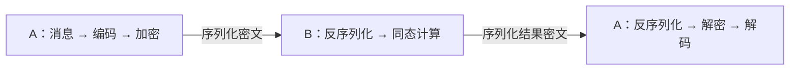

# HiFHE

HiFHE 是全同态加密密码库，提供 BGV 算法能力。

全同态加密（FHE，Fully Homomorphic Encryption）支持通过组合密文运算表达通用计算。
具体库可执行哪些运算、支持多少层连续计算，取决于实现和参数。
HiFHE 当前提供下面列出的能力，公共接口暂不提供密文×密文或自举，不能据此执行任意深度的密文计算。

## 功能

| 算法 | 数据与计算含义 | 当前对外能力 |
| --- | --- | --- |
| BGV | 整数向量；运算结果按明文模数 t 取模 | 预设参数、编解码、密钥生成、加解密、密文加密文、密文加明文、密文×明文、取负和加噪 |

- **数据传输**：支持明文、密文的序列化与反序列化，用于存储和传输；BGV 支持原生接口与 Provider 之间的密文互通。
- **按需裁剪**：BGV 和 Provider 接入可独立启用或关闭。

支持独立 C API 和 openHiTLS Provider 两种接入方式。C API 见 [hifhe.h](include/hifhe.h)，
通过不透明的 `HIFHE_Ctx` 和 `HIFHE_HEText` 管理上下文、明文和密文，传输时转换为字节流。

## 使用流程与场景

以 BGV 为例，A、B 配置相同的预设参数。A 生成并持有密钥；B 执行加法和密文×明文运算时无需持有密钥。



原生 API 中，`HIFHE_Encode` / `HIFHE_Decode` 在数值与算法明文之间转换；
`HIFHE_Encrypt` / `HIFHE_Decrypt` 在算法明文与密文之间转换；
`HIFHE_Add` / `HIFHE_Mul` 执行同态计算。
编码本身不保护数据，序列化也只负责将对象转成字节流：序列化后的明文仍然不是密文。

当前 BGV 能力可用于加密数据求和、公开系数的加权计算，以及 [Demo](testcode/demo/README.md) 中的隐私查询流程。
Demo 中 A 加密查询，B 计算条目与查询的差值、乘以非零掩码并加噪，再由 A 解密判断匹配结果。
这些流程都需要按支持的运算组织，不能直接将普通程序交给 HiFHE 执行。
密文通常比原始数据大，同态计算也有额外开销，需根据参数和工作负载评估。

使用前需初始化 openHiTLS。完整的初始化、返回值检查和资源释放见
[原生 Demo](testcode/demo/hifhe_bgv_demo.c) 和 [Provider Demo](testcode/demo/hifhe_bgv_provider_demo.c)。

## 构建

依赖 CMake 3.16 或更高版本、C11 编译器和 openHiTLS。不传
`--hitls_dir` 时，脚本会下载并编译 openHiTLS。默认同时生成
`libhifhe.so` 和 `libhifhe.a`。

```sh
bash testcode/script/build_hifhe.sh
```

使用已有 openHiTLS：

```sh
bash testcode/script/build_hifhe.sh --hitls_dir /path/to/openHiTLS
# 当前工作区：
bash testcode/script/build_hifhe.sh --hitls_dir /usr1/cq/openhitls/openhitls
```

只生成一种库：

```sh
bash testcode/script/build_hifhe.sh shared
bash testcode/script/build_hifhe.sh static
```

使用已编译的 openHiTLS 直接执行 CMake：

```sh
cmake -S . -B build \
    -DHITLS_ROOT_PATH=/path/to/openHiTLS \
    -DHITLS_LIB_DIR=/path/to/openHiTLS/build \
    -DHIFHE_BUILD_SHARED=ON \
    -DHIFHE_BUILD_STATIC=ON \
    -DHIFHE_BGV=ON \
    -DHIFHE_ENABLE_ASAN=OFF \
    -DHIFHE_ENABLE_GCOV=OFF
cmake --build build --parallel
```

CMake 配置：

| 变量 | 默认值 | 说明 |
| --- | --- | --- |
| `HITLS_ROOT_PATH` | `platform/openhitls` | openHiTLS 源码目录 |
| `HITLS_LIB_DIR` | `${HITLS_ROOT_PATH}/build` | `hitls_crypto`、`hitls_bsl` 库目录 |
| `HIFHE_BUILD_SHARED` | `ON` | 生成 `libhifhe.so` |
| `HIFHE_BUILD_STATIC` | `ON` | 生成 `libhifhe.a` |
| `HIFHE_BGV` | `ON` | 必须启用；关闭时配置报错 |
| `HITLS_PROVIDER` | `ON` | 启用 openHiTLS Provider 接入 |
| `HIFHE_BUILD_TESTS` | `OFF` | 构建原生接口及内核白盒用例 |
| `HIFHE_ENABLE_ASAN` | `OFF` | 启用 AddressSanitizer |
| `HIFHE_ENABLE_GCOV` | `OFF` | 启用覆盖率 |

至少启用一种库类型。BGV 是唯一算法，不能关闭。仅使用原生接口时，可以关闭 Provider：

```sh
bash testcode/script/build_hifhe.sh --disable provider
```

安装命令：`cmake --install build --prefix /path/to/prefix`。

使用安装 SDK 的 Provider 应用需在编译时定义 `HITLS_PROVIDER`，并添加 openHiTLS 头文件路径：

```sh
cc -DHITLS_PROVIDER -I/path/to/prefix/include \
    -I/path/to/openHiTLS/include/crypto -I/path/to/openHiTLS/include/bsl -c app.c
```

该宏公开 Provider 属性、参数键及初始化声明，不能为已裁剪的库补上 Provider 实现。
通过 `add_subdirectory` 链接 `hifhe_provider` CMake 目标时，Provider 开启后会自动传递该宏。
直接使用安装 SDK 的原生应用不需要定义此宏。

## 测试

所有用例统一放在 `testcode/sdv`，使用 `.c + .data` 和通用 SDV 断言、执行器。
增加 `-DHIFHE_BUILD_TESTS=ON` 后，默认构建当前特性支持的全部套件：

```sh
cmake -S . -B build -DHIFHE_BUILD_TESTS=ON
cmake --build build --parallel
ctest --test-dir build --output-on-failure
```

公共接口用例链接正式库，内核用例直接链接实现对象，Provider 用例动态加载正式库。
也可以通过脚本构建和执行同一批套件：

```sh
bash testcode/script/build_sdv.sh
bash testcode/script/execute_sdv.sh
```

Provider 与原生 API 各有一套 Demo，均覆盖一次加密、无密钥服务端计算与客户端解密：

```sh
bash testcode/script/build_demo.sh
./testcode/output/demo/hifhe_bgv_provider_demo  # Provider
./testcode/output/demo/hifhe_bgv_demo           # 原生 API
```

随机数与 Hash 固定使用内置 openHiTLS 实现。

原生参数仅使用 `HIFHE_SetParaById`；不提供参数对象、公私钥导入导出和密文×密文能力。
`HIFHE_Mul` 支持密文×明文，原生接口不依赖 `BSL_Param`。
`-DHITLS_PROVIDER=OFF` 关闭 Provider 及 BSL 参数适配，并裁剪相关用例。
