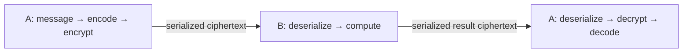

# HiFHE

HiFHE is a homomorphic encryption library with a BGV implementation.

Fully homomorphic encryption (FHE) supports expressing general computation through
combinations of ciphertext operations. The available operations and computation
depth depend on the implementation and parameters. HiFHE exposes the capabilities
listed below; its public API does not offer ciphertext/ciphertext multiplication
or bootstrapping and cannot execute computations of arbitrary depth.

## Features

| Algorithm | Data and arithmetic | Current public capabilities |
| --- | --- | --- |
| BGV | Integer vectors; arithmetic modulo the plaintext modulus t | Presets, encoding/decoding, key generation, encryption/decryption, ciphertext/ciphertext and ciphertext/plaintext addition, ciphertext/plaintext multiplication, negation, and noise addition |

- **Data transport:** plaintext and ciphertext serialization/deserialization for
  storage and transport. BGV ciphertexts interoperate between native and Provider APIs.
- **Build options:** BGV and Provider integration can be enabled independently.

HiFHE provides a native C API and an openHiTLS Provider. The C API in
[hifhe.h](include/hifhe.h) uses opaque `HIFHE_Ctx` and `HIFHE_HEText` types for
contexts, plaintexts, and ciphertexts. Local computation uses objects; transport
uses serialized bytes.

## Workflow and use cases

For BGV, A and B select the same preset. A generates and holds the keys; B needs
no keys for addition and ciphertext/plaintext multiplication.



In the native API, `HIFHE_Encode` / `HIFHE_Decode` convert between numeric values
and algorithm plaintexts. `HIFHE_Encrypt` / `HIFHE_Decrypt` convert between those
plaintexts and ciphertexts. `HIFHE_Add` / `HIFHE_Mul` perform homomorphic computation.
Encoding does not protect data, and serialization only converts objects to bytes:
a serialized plaintext is still not encrypted.

Current BGV operations support encrypted sums, weighted calculations with public
coefficients, and the private-query workflow in the [demos](testcode/demo/README.md).
In that workflow, A encrypts a query. B subtracts it from entries, multiplies by
nonzero masks, adds noise, and returns ciphertexts for A to decrypt and check for
matches. Applications must express their computations using supported operations;
HiFHE does not execute arbitrary programs directly. Ciphertexts are typically
larger than the original data, and homomorphic operations add computational cost;
evaluate both for the chosen parameters and workload.

Initialize openHiTLS before using HiFHE. See the
[native demo](testcode/demo/hifhe_bgv_demo.c) and
[Provider demo](testcode/demo/hifhe_bgv_provider_demo.c) for initialization, error handling,
and resource cleanup.

## Build

Requirements: CMake 3.16 or newer, a C11 compiler, and openHiTLS. The helper
script clones and builds openHiTLS when `--hitls_dir` is omitted. By default it
builds both `libhifhe.so` and `libhifhe.a`.

```sh
bash testcode/script/build_hifhe.sh
```

Use an existing openHiTLS checkout:

```sh
bash testcode/script/build_hifhe.sh --hitls_dir /path/to/openHiTLS
# This workspace:
bash testcode/script/build_hifhe.sh --hitls_dir /usr1/cq/openhitls/openhitls
```

Build one library type:

```sh
bash testcode/script/build_hifhe.sh shared
bash testcode/script/build_hifhe.sh static
```

Use CMake directly with an already-built openHiTLS checkout:

```sh
cmake -S . -B build \
    -DHITLS_ROOT_PATH=/path/to/openHiTLS \
    -DHITLS_LIB_DIR=/path/to/openHiTLS/build \
    -DHIFHE_BUILD_SHARED=ON \
    -DHIFHE_BUILD_STATIC=ON \
    -DHIFHE_BGV=ON \
    -DHIFHE_ENABLE_ASAN=OFF \
    -DHIFHE_ENABLE_GCOV=OFF
cmake --build build --parallel
```

CMake options:

| Variable | Default | Description |
| --- | --- | --- |
| `HITLS_ROOT_PATH` | `platform/openhitls` | openHiTLS source directory |
| `HITLS_LIB_DIR` | `${HITLS_ROOT_PATH}/build` | `hitls_crypto` and `hitls_bsl` directory |
| `HIFHE_BUILD_SHARED` | `ON` | Build `libhifhe.so` |
| `HIFHE_BUILD_STATIC` | `ON` | Build `libhifhe.a` |
| `HIFHE_BGV` | `ON` | Required; disabling BGV is a configuration error |
| `HITLS_PROVIDER` | `ON` | Build openHiTLS Provider integration |
| `HIFHE_BUILD_TESTS` | `OFF` | Build native tests and internal regressions |
| `HIFHE_ENABLE_ASAN` | `OFF` | Enable AddressSanitizer |
| `HIFHE_ENABLE_GCOV` | `OFF` | Enable coverage |

At least one library type must be enabled. BGV is the only algorithm and cannot be
disabled. For native API use, Provider integration can be disabled:

```sh
bash testcode/script/build_hifhe.sh --disable provider
```

Install with `cmake --install build --prefix /path/to/prefix`.

Provider applications using the installed SDK must define `HITLS_PROVIDER`
when compiling and add the openHiTLS header paths:

```sh
cc -DHITLS_PROVIDER -I/path/to/prefix/include \
    -I/path/to/openHiTLS/include/crypto -I/path/to/openHiTLS/include/bsl -c app.c
```

This exposes Provider attributes, parameter keys, and the initialization
declaration; it does not enable Provider support in a library built without it.
Applications linking the `hifhe_provider` CMake target through `add_subdirectory`
inherit this definition when Provider support is enabled. Native applications
using the installed SDK do not need this definition.

## Test

All tests use the shared SDV assertions and runner, with `.c + .data` files under `testcode/sdv`.
Set `-DHIFHE_BUILD_TESTS=ON` to build all suites supported by the selected features:

```sh
cmake -S . -B build -DHIFHE_BUILD_TESTS=ON
cmake --build build --parallel
ctest --test-dir build --output-on-failure
```

Public API tests link the production library, kernel tests link implementation objects,
and Provider tests load the production library dynamically. The scripts run the same suites:

```sh
bash testcode/script/build_sdv.sh
bash testcode/script/execute_sdv.sh
```

Separate Provider and native API demos cover one encryption, a server with no
keys, byte transport, and client decryption:

```sh
bash testcode/script/build_demo.sh
./testcode/output/demo/hifhe_bgv_provider_demo  # Provider
./testcode/output/demo/hifhe_bgv_demo           # Native API
```

Random and Hash operations use the built-in openHiTLS implementation.

Native parameters use `HIFHE_SetParaById`; custom parameter objects and key
import/export are omitted. `HIFHE_Mul` supports ciphertext/plaintext products.
Native APIs do not use `BSL_Param`. `-DHITLS_PROVIDER=OFF` removes the Provider, BSL adapters,
and their tests.
