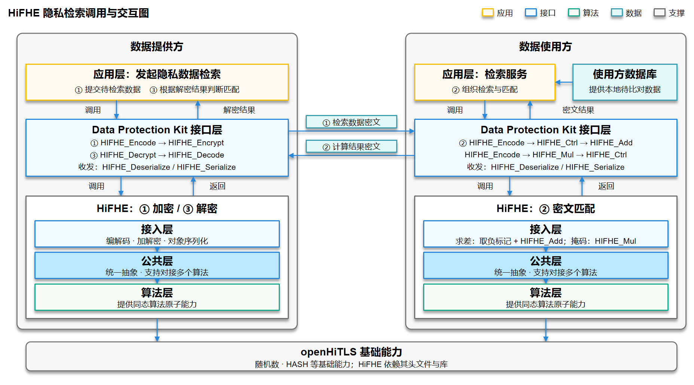
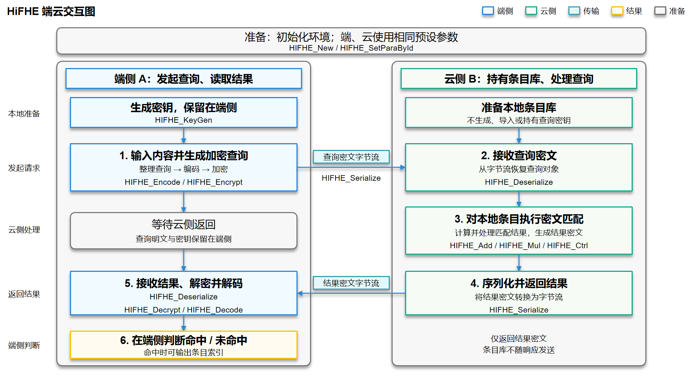

# HiFHE
本仓库包含开源软件HiFHE，为OpenHarmony提供同态加密密码库，依赖openHiTLS的公共基础能力。

## 概述

HiFHE是面向OpenHarmony的同态加密密码库，当前仅构建BGV算法，提供参数配置、算法上下文管理、密钥生成与公私钥导入导出、整数向量编码解码、加解密及同态运算等能力。HiFHE以动态库形式构建，依赖openHiTLS的公共头文件和库。

## 同态加密简介

### 概念

同态加密（Homomorphic Encryption, HE）是一类允许在密文上直接执行计算、且解密结果与对明文做同样计算一致的加密技术。其核心价值在于：数据拥有者可将密文交给不可信的计算方（如云端、第三方服务）完成运算，计算方全程不接触明文，数据拥有者取回密文结果后本地解密即可得到答案。这一特性使"数据可用不可见"成为可能，从根本上解耦了数据的"计算权"与"可见权"。

按支持的运算深度，同态加密通常分为：

- **半同态加密（Partially HE, PHE）**：仅支持无限次单一运算（加法或乘法），如 RSA、Paillier。
- **些许同态加密（Somewhat HE, SHE）**：支持有限次数的加法和乘法，运算深度受噪声增长约束。
- **全同态加密（Fully HE, FHE）**：支持任意深度运算，需借助自举（bootstrapping）刷新噪声。BGV 属于可层级化的全同态方案（leveled FHE），在固定深度内无需自举即可完成完整算术电路计算。

> 业界关于同态加密的术语、安全参数与安全等级的标准化定义，参见 HomomorphicEncryption.org 发布的 [Homomorphic Encryption Standard](https://homomorphicencryption.org/standard/)。

### 典型场景

| 场景 | 说明 |
| --- | --- |
| 隐私计算外包 | 终端设备加密数据后上传，服务端在密文上完成统计、聚合等运算并返回密文结果，终端解密。服务端不持有明文，满足数据不出域要求。 |
| 多方协同分析 | 多个数据提供方各自加密数据后汇聚，由计算方在密文上联合运算，得到聚合结果而不泄露任一方明细。 |
| 隐私查询 | 客户端将查询条件编码加密后提交，服务端在密文上匹配并返回加密结果，服务端不知查询内容与命中记录。|

## 仓库目录介绍

```
third_party_hifhe
├── include/                     # 对外公开头文件，OpenHarmony 组件引用 hifhe 时可见
│   ├── hifhe.h                  #   原生接口：上下文、编解码、加解密、同态运算、序列化
│   ├── hifhe_types.h            #   参数 ID、控制命令、预设参数集等类型定义
│   └── hifhe_err.h              #   错误码定义
├── src/                         # 库源码
│   ├── api/                     #   原生接口实现与公共抽象
│   ├── common/                  #   内部公共定义
│   ├── provider/                #   openHiTLS provider 适配层
│   │   ├── hifhe_provider.c     #     provider 初始化与能力注册
│   │   └── hifhe_pkey.c         #     PKEY 适配
│   ├── bgv/                     #   BGV 算法实现
│   │   ├── include/             #     BGV 对外头文件
│   │   └── src/
│   │       ├── adapter/         #       适配层：API 转换、ctrl 分发、参数与序列化
│   │       ├── basic/           #       基础设施：上下文、随机数、向量
│   │       ├── kernel/          #       核心算子：模运算、NTT、素数、采样
│   │       ├── rlwe/            #       RLWE 层：CRT 运算、RNS 与环上下文
│   │       └── bgv/             #       BGV 算法层：参数、编解码、加解密、同态运算
│   └── ckks/                    #   CKKS 算法实现（OpenHarmony 构建未启用）
├── cmake/                       # CMake 构建模块与配置模板
├── testcode/                    # 测试、示例与性能代码
│   ├── sdv/                     #   基于 openHiTLS SDV 框架的测试套件
│   ├── benchmark/               #   性能基准
│   ├── demo/                    #   使用示例
│   ├── framework/               #   测试框架
│   ├── common/                  #   测试公共工具
│   └── script/                  #   构建与运行脚本
├── BUILD.gn                     # OpenHarmony GN 构建脚本
├── bundle.json                  # OpenHarmony 部件元数据
└── CMakeLists.txt               # CMake 构建入口
```

> OpenHarmony 平台通过 `BUILD.gn` 构建，默认仅编译 BGV 算法（`HIFHE_ENABLE_BGV`）。`include/` 与 `src/bgv/include/` 为对外可见头文件目录。

## 功能特性

特性围绕"密文上完成计算、明文不出域"这一目标组织，按使用流程分为四组。

### 1. 公共能力

- **原生接口**：提供 `HIFHE_New`、`HIFHE_Encode`、`HIFHE_Encrypt`、`HIFHE_Add`、`HIFHE_Mul`、`HIFHE_Decrypt`、`HIFHE_Serialize`、`HIFHE_Deserialize` 等接口。
- **provider 适配**：保留 openHiTLS provider 集成能力，支持算法注册与 EAL 调用。

### 2. 参数与上下文管理

- **预设参数集**：内置多组经校验的安全参数预设（如 `HIFHE_BGV_2048_48_17BIT`、`HIFHE_BGV_8192_44x4_17BIT`），覆盖不同安全等级与计算深度，避免使用方自行选参出错。
- **上下文生命周期**：支持算法上下文的创建、复制与释放。复制上下文可共享 NTT 表等重计算资源，适合反复加解密的批处理场景，降低单次开销。
- **确定性种子**：支持通过 `HIFHE_CTRL_BGV_SET_SEED` 设定种子，相同种子与预设产生字节一致的密钥，便于测试复现与密钥派生分发。

### 3. 密钥与编解码

- **密钥生成与导入导出**：支持公私钥生成及序列化导入导出，支撑"数据提供方用公钥加密、数据拥有方持私钥解密"的多方协同模式与密钥托管分发。
- **整数向量批编码**：单条密文可打包多个整数槽位（slot 数等于多项式次数），一次加解密完成多值运算，类比 SIMD，显著提升聚合统计的吞吐。

### 4. 加解密与同态运算

这是同态加密实现"密文上计算"的核心能力，每组运算对应一个场景价值：

- **公钥加密 / 私钥解密**：非对称结构天然支持"多方加密、单方解密"——任意持有公钥的参与方可贡献加密数据，仅私钥持有方可解读最终结果，适合数据汇聚与协同分析。
- **同态加法、乘法**：在密文上执行加法与乘法，对应明文算术电路，是隐私统计、聚合、条件判断的计算基础。
- **重线性化（Relinearization）**：乘法后密文维度增长（size 3），重线性化将其压缩回 size 2，控制后续运算开销，使深层算术电路可行。
- **模切换（Modulus Switching）**：逐级降低密文模数链，抑制噪声增长、控制密文体积，在精度与可计算深度间取得平衡，延长可执行的运算链路。
- **旋转（Rotation）**：在打包密文的槽位间循环搬移数据，使同态算法能在单条密文内部重排数据，支撑矩阵运算等需要数据对齐的复杂计算。
- **重随机化（Rerandomization）**：在保持明文不变的前提下注入新噪声，断开同一明文不同密文间的可链接性，适用于需要公开或多次发布密文的场景。

## 构建指导

适配OpenHarmony平台的编译脚本请见[gn构建脚本](BUILD.gn)。


以rk3568平台为例，编译命令为：
```bash
./build.sh --product-name rk3568 --ccache --build-target libhifhe
```
编译完成后会生成动态库libhifhe.so。

## 应用使用场景样例

HiFHE 在 OpenHarmony 中的落地场景是**跨应用个人隐私数据检索**：用户的个人隐私数据存放在某一应用（数据提供方）中，另一应用（数据使用方）需要在不接触明文的前提下完成检索匹配。HiFHE 在数据保护服务隐私计算链路中的调用关系如下：应用层 → Data Protection Kit 接口层 → HiFHE → openHiTLS。

该能力由**数据保护服务**中的**隐私计算模块**调用 HiFHE 实现，典型流程如下：

1. **数据提供方(应用层)** 使用同态算法加密待检索数据并发送给数据使用方，此处会触发应用通过Data Protection Kit调用HiFHE相关算法相关流程。
    - **应用层**：发起隐私数据检索的应用，将数据提交至数据保护服务。
    - **Data Protection Kit 接口层**：HiFHE 的调用方，调用 HiFHE 在密文上完成匹配运算并返回密文结果。
    - **HiFHE**：核心能力按调用链路细分为以下模块：
      - **接入层**：HiFHE对外提供的计算接口，包含加解密，加，减，乘等。
      - **公共层**：HiFHE提供的公共抽象能力，下层可以对接多个算法。
      - **算法层**：基础的算法计算层，主要提供算法原子能力。
    - **openHiTLS**：提供公共基础能力（随机数、HASH等基础能力），HiFHE 依赖其头文件与库。
2. **数据使用方**将检索数据密文与使用方数据库数据做同态计算，并将计算结果返回。
3. **数据提供方(应用层)** 使用同态算法解密返回的计算结果，并根据解密数据判断数据是否检索匹配成功。

流程图如下:



相关接口定义与使用说明参见 [Data Protection Kit（数据保护服务）参考文档](https://gitcode.com/openharmony/docs/tree/master/zh-cn/application-dev/reference/apis-data-protection-kit)。

## OpenHarmony系统内部如何使用hifhe

OpenHarmony中系统部件需要在BUILD.gn中引用hifhe部件以使用hifhe。
 
```
// BUILD.gn
external_deps += [ "hifhe:libhifhe" ]
```

使用hifhe相关接口前，需在源文件中引用对应头文件：

```c
#include "hifhe.h"       // 原生接口：上下文、编解码、加解密、同态运算、序列化
#include "hifhe_types.h" // 参数ID、控制命令(HIFHE_CTRL_BGV_*)、预设参数集(HIFHE_BGV_PRESET)等类型定义
#include "hifhe_err.h"   // 错误码定义
```

系统内部使用HiFHE完成端云查询的隐私与匹配，典型流程如下：

1. 数据提供方(A)调用 HIFHE_Encode、HIFHE_Encrypt 对检索数据进行编码和加密，将密文发送给数据使用方；
2. 数据使用方(B)结合本地数据库，通过 HIFHE_Ctrl、HIFHE_Add 和 HIFHE_Mul 完成求差、掩码处理及加噪，并返回计算结果密文；
3. 数据提供方(A)调用 HIFHE_Decrypt、HIFHE_Decode 恢复结果，由应用判断是否匹配。

双方通过 HIFHE_Serialize、HIFHE_Deserialize 完成对象与传输字节流的转换，网络收发由应用或服务负责。在内部架构上，HiFHE 接入层承接公开接口调用，公共层提供统一抽象与算法适配，算法层执行基础原子运算，并依赖 openHiTLS 提供随机数、HASH 等公共基础能力。



具体接口使用可参考[API开发指南](docs/HiFHE_API使用说明.md)。

## License

Mulan PSL v2

见[LICENSE](LICENSE).
